# DBYTE-HOLYC-OPT PIPELINE

```mermaid
flowchart LR
    subgraph RESOURCE[READ-ONLY RESOURCE]
        HT[DBYTE-HOLYC-TOOLS at pinned commit]
        ISOID[TempleOSTS ISO identity]
        ARC[HolyArchive extractor]
        OLD[Compiler archaeology only]
        HT --> ISOID
        HT --> ARC
        HT --> OLD
    end

    subgraph CORPUS[RARE TERRY CORPUS]
        ISO[TempleOSTS.iso]
        RAW[raw archive bytes]
        EXP[expanded historical files]
        NAV[normalized holy navigation tree]
        MAN[compiler path byte and SHA256 manifest]
        ISO --> RAW
        ISO --> EXP
        ISO --> NAV
        EXP --> MAN
    end

    subgraph SEAL[SEAM ADJUDICATION]
        PIPE[Locate original compile pipeline]
        PASS[Identify original optimizer passes]
        POINT[Seal insertion point from exact bytes]
        PIPE --> PASS --> POINT
    end

    subgraph TARGET[ORIGINAL INTERNAL COMPILER]
        SRC[Rare original HolyC source]
        FRONT[Original lexer and parser]
        IC[Original intermediate code]
        PREPASS[Original early optimizer]
        POSTPASS[Original sizing fix-up and emission]
        X64[Original x86-64 JIT or AOT output]
        SRC --> FRONT --> IC --> PREPASS
        POSTPASS --> X64
    end

    subgraph DEADBYTE[OVERHEAVEN GATE]
        VERIFY1[Pre-rewrite verifier]
        FACTS[Temporary facts]
        REWRITE[One proved rewrite]
        VERIFY2[Post-rewrite verifier]
        VERIFY1 --> FACTS --> REWRITE --> VERIFY2
    end

    subgraph HARNESS[DIFFERENTIAL HARNESS]
        CASE[Byte-identified test case]
        BASE[Unmodified rare compiler]
        CAND[Candidate rare compiler]
        BO[Baseline observation]
        CO[Candidate observation]
        JUDGE[Semantic judge]
        METRIC[Code size and timing]
        CASE --> BASE --> BO
        CASE --> CAND --> CO
        BO --> JUDGE
        CO --> JUDGE
        JUDGE --> METRIC
    end

    ISOID --> ISO
    ARC --> RAW
    ARC --> EXP
    ARC --> NAV
    MAN --> PIPE
    OLD -. architectural clue only .-> PIPE
    POINT --> VERIFY1
    PREPASS --> VERIFY1
    VERIFY2 --> POSTPASS
    X64 --> CAND
```

Only `expanded` historical files can become a patch base. The normalized
`holy` tree can help locate symbols but cannot authorize source changes.
Common public mirrors and later forks are excluded from the target path.

No optimizer source is introduced until the insertion seam is sealed from the
exact internal compiler files. The semantic judge decides correctness;
measurements never override a mismatch.
