# DBYTE-HOLYC-OPT PIPELINE

```mermaid
flowchart LR
    subgraph RESOURCE[READ-ONLY RESOURCE]
        HT[DBYTE-HOLYC-TOOLS pinned commit]
        ISOID[TempleOSTS exact identity]
        ARC[HolyArchive extractor]
        OLD[Later compiler archaeology]
        HT --> ISOID
        HT --> ARC
        HT --> OLD
    end

    subgraph CORPUS[RARE TERRY CORPUS]
        ISO[TempleOSTS.iso]
        RAW[raw archive bytes]
        EXP[expanded historical files]
        NAV[normalized holy navigation]
        MAN[all expanded paths bytes SHA256]
        ISO --> RAW
        ISO --> EXP
        ISO --> NAV
        EXP --> MAN
    end

    subgraph DISCOVERY[RARE COMPILER DISCOVERY]
        CAT[Compiler-like paths and functions]
        ANCHOR[Later-era anchor counts]
        ID[Manual compiler identity]
        PASS[Manual pass identity]
        POINT[Manual seam identity]
        MAN --> CAT
        MAN --> ANCHOR
        CAT --> ID --> PASS --> POINT
        ANCHOR --> ID
    end

    subgraph TARGET[ORIGINAL INTERNAL COMPILER]
        SRC[Rare original HolyC source]
        FRONT[Original lexer and parser]
        IC[Original intermediate form]
        PREPASS[Original early optimization]
        POSTPASS[Original sizing fix-up emission]
        X64[Original x86-64 output]
        SRC --> FRONT --> IC --> PREPASS
        POSTPASS --> X64
    end

    subgraph DEADBYTE[OVERHEAVEN GATE]
        VERIFY1[Pre-rewrite verifier]
        FACTS[Temporary facts]
        REWRITE[One proved rewrite]
        VERIFY2[Post-rewrite verifier]
        VERIFY1 --> FACTS --> REWRITE --> VERIFY2
    end

    subgraph HARNESS[DIFFERENTIAL HARNESS]
        CASE[Byte-identified test case]
        BASE[Unmodified rare compiler]
        CAND[Candidate rare compiler]
        BO[Baseline observation]
        CO[Candidate observation]
        JUDGE[Semantic judge]
        METRIC[Code size and timing]
        CASE --> BASE --> BO
        CASE --> CAND --> CO
        BO --> JUDGE
        CO --> JUDGE
        JUDGE --> METRIC
    end

    ISOID --> ISO
    ARC --> RAW
    ARC --> EXP
    ARC --> NAV
    OLD -. naming clue only .-> CAT
    POINT --> VERIFY1
    PREPASS --> VERIFY1
    VERIFY2 --> POSTPASS
    X64 --> CAND
```

Only `expanded` historical files can become a patch base. The normalized
`holy` tree can help navigation but cannot authorize source changes.

The exact 1.10 corpus rejected `COCCompile` as a required marker. Later compiler
names are therefore discovery clues only, not target contracts.

No optimizer source is introduced until the compiler, pass pipeline, and seam
are identified from exact internal bytes. The semantic judge decides
correctness; measurements never override a mismatch.
