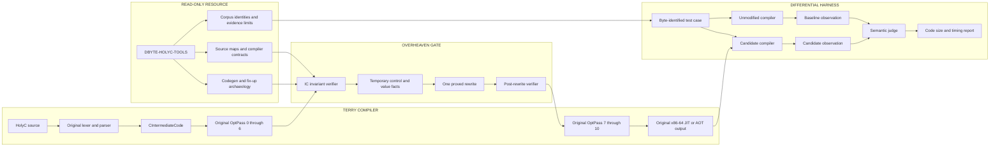

# DBYTE-HOLYC-OPT PIPELINE

The resource repository is not linked into the compiler. It supplies pinned
facts and identities. The optimizer operates on Terry's existing intermediate
code and returns control to Terry's backend.

The semantic judge decides correctness. Measurements never override a mismatch.
